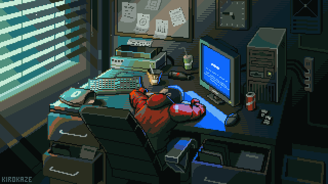

<h1 align="center">Hey 👨‍💻 I'm Akmal</h1>

  

  
   
  🎨 Artwork by <a href="KIROKAZE-LINK">Kirokaze</a> (Gerardo Quiroz) — used with permission

## 📌 About Me

I'm Akmal, a final-year Computer Science student at Universiti Malaysia Pahang Al-Sultan Abdullah (UMPSA), majoring in Computer Systems & Networking. I'm most interested in security operations and network engineering, and I like learning by building things myself, then breaking them to see what happens.

Right now I'm working on a home SOC lab where Wazuh SIEM sends alerts to an n8n workflow that checks the attacker's IP on AbuseIPDB and notifies me on Telegram. Before that, I configured real Cisco routers and switches and monitored them with PRTG using the FCAPS model. I'm looking for an industrial training placement from **February to August 2027**.

## 🛠️ Tech Stack

**🛡️ Security & Systems**

  

  
  
  
  

**🌐 Networking**

  
  
  
  

**💻 Programming, Data & Cloud**

  

  
  

## 🚀 Featured Projects

| Project | What it does |
|---|---|
| 🛡️ [**SOC Home Lab**](https://github.com/akmalmahazan/soc-home-lab) | Wazuh SIEM → n8n SOAR → AbuseIPDB → Telegram. Tested with a simulated SSH brute-force attack. |
| 📧 **MailShield AI** *(final-year project)* | Detects phishing emails in Gmail and explains *why* each one was flagged, using LIME and SHAP. |
| 🌐 **Network Monitoring with PRTG** *(coursework)* | Real Cisco router and switches with VLANs, monitored across all five FCAPS areas, with automated config backups in Python. |
| 🤖 **Infaq Bot** *(private)* | Telegram bot that handles monthly contribution tracking for a 37-member community programme. |
| 🅿️ [**FKPark**](https://github.com/akmalmahazan/fkpark) | Web Engineering group project: a parking website with Admin, Student and Security roles to check and manage parking availability. Built with PHP. |

## 📊 GitHub Stats

  
  

  

## 🔗 Connect with Me

  
  &nbsp;
  

## 🐍 Contribution Snake

  <picture>
    <source media="(prefers-color-scheme: dark)" srcset="https://raw.githubusercontent.com/akmalmahazan/akmalmahazan/output/github-snake-dark.svg" />
    
  </picture>

  

